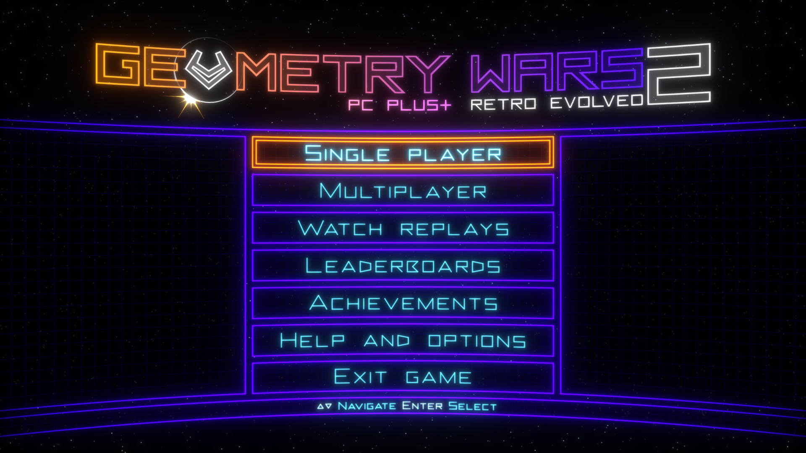
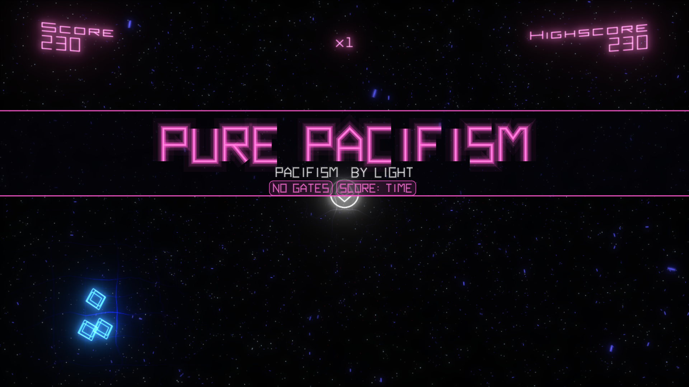
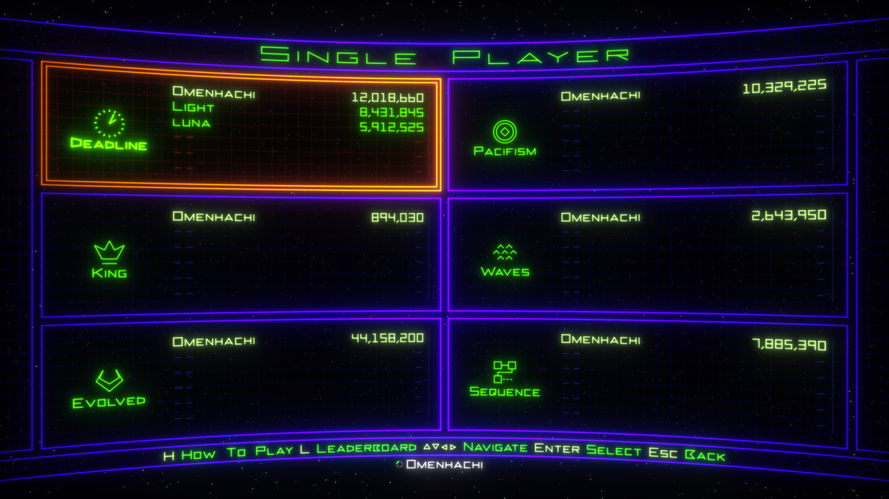
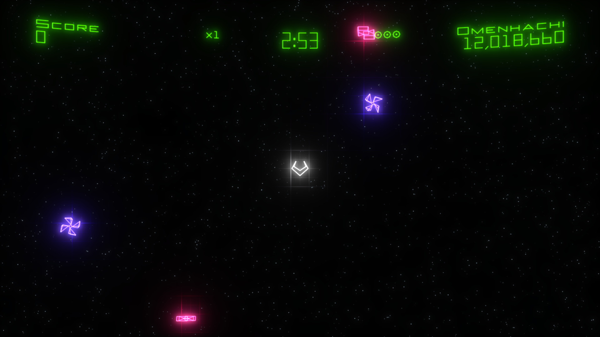
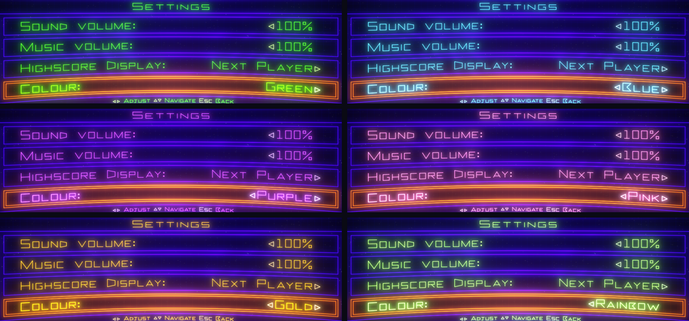
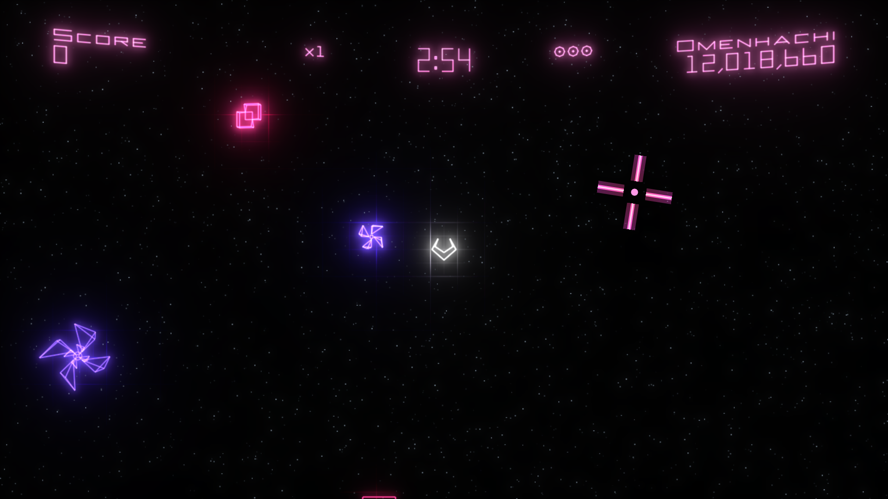
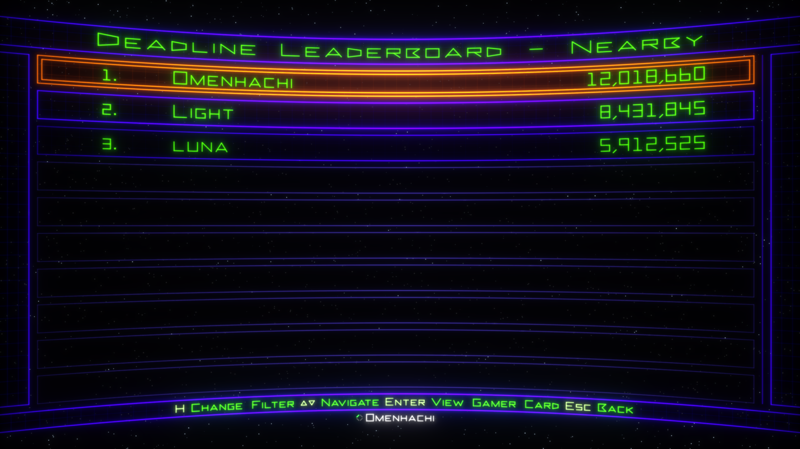
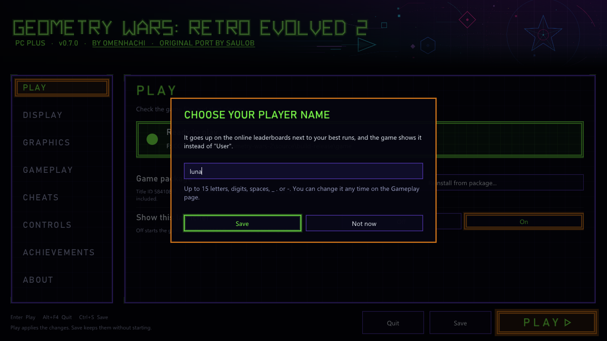

<div align="center">

# Geometry Wars 2 PC Plus

### Geometry Wars: Retro Evolved 2, running natively on PC, with proper mouse aim, online leaderboards and the little touches that make it feel at home on a PC

[](https://github.com/omenhachi/geometry-wars-2-pc-plus/releases/latest)


<sub>The original Xbox 360 game, statically recompiled to native PC code with the <a href="https://github.com/rexglue/rexglue-sdk">ReXGlue SDK</a>. <b>No game files included</b>: you need your own Geometry Wars: Retro Evolved 2 Xbox Live Arcade package.</sub>

</div>



PC Plus builds on [saulob's excellent PC port](https://github.com/saulob/geometry-wars-retro-evolved-2-recompiled). It's not emulation: the game's own code runs natively, with high frame rates, high resolutions and modern options. PC Plus adds the things I missed playing it on a PC, especially with a keyboard and mouse.

**[Download the latest release](https://github.com/omenhachi/geometry-wars-2-pc-plus/releases/latest)**

## What PC Plus adds

- **Real mouse aim.** Shots go straight to the cursor, instantly, like a modern twin-stick shooter. Right-click bombs, Escape pauses. A controller still plays the original way.
- **An animated neon crosshair** that spins and pinches as you fire, so it never gets lost in the chaos.
- **Keyboard prompts and a keyboard and mouse controls screen**, drawn in the game's own style.
- **Online leaderboards.** Pick a player name and the game's Everyone boards show PC Plus players from around the world.
- **Nearby players, in place of Xbox Live friends.** Each mode lists the players just above and below you, and while you play, the corner shows the next score to beat, moving up as you pass each one.
- **Pick your colour.** Green, Blue, Purple, Pink, Gold, Rainbow or any colour you like, for the menus, HUD, icons and crosshair, right from the game's Settings menu.
- **A results screen after every single-player run**, inspired by Pac-Man CE DX: your score over time with deaths, bombs and your best moment marked, the enemies you destroyed, and what your black holes and gates were worth. It sits over the Game Over screen and never slows a retry.
- **Watch your runs again.** Every single-player run is saved as a replay, and **Watch replays** on the main menu plays them back exactly, at any frame rate. Star the ones you love to keep them. A replay never counts: no score, stats or achievements.
- **Make your own modes.** **Custom modes** on the main menu plays the game's modes with new rules: no gates, a score that's how long you survive, more or fewer lives and bombs, endless bombs, a time limit, faster or slower play. Five come with it (Pure Pacifism, Overdrive, One Life, Bomb Party and Speed Test), and making your own is a small text file in `user_data/mods`: see [docs/MODDING.md](docs/MODDING.md). Custom runs keep their own bests and replays, and never count for leaderboards, achievements or unlocks.
- **Deadline's hidden spawn rank, if you want it.** Turn on **Deadline rank info** and the HUD shows K (weighted kills), G (geoms) and the rank the next wave will set, with a little pop when a wave raises it. Off by default; it only shows information, so runs still count online.
- **A launcher that looks like Geometry Wars**, and PC PLUS+ on the title screen.

## From the original port

saulob's port does the heavy lifting, and all of it is still here:

- Frame rates up to 240 or unlimited, with the game still running at its original speed
- Up to 4x render resolution (5120×2880), ultrawide and other aspect ratios, FXAA and MSAA
- All 12 achievements, local scores and progression, no Xbox Live needed
- Optional cheats, controller vibration and keyboard remapping
- A launcher that installs the game from your own package, and updates itself
- An experimental native Linux build, which you can build from source for now (see below)

## Screenshots

**Custom modes.** Each one opens with its name and rules.



**Nearby players.** The people closest to your score, in every mode.



**Your next rival.** The corner shows the score to beat, and moves up the moment you pass it.



**Your colour.** Help and options, Settings, Colour.





<table>
<tr>
<td width="50%"><br><sub><b>The Nearby board</b>, in place of Friends.</sub></td>
<td width="50%"><br><sub><b>Choose your player name</b>. The launcher asks once.</sub></td>
</tr>
</table>

## Getting started

**You need:** Windows 10 or 11 (64-bit) with a DirectX 12 graphics card, the latest [Microsoft Visual C++ Redistributable (x64)](https://aka.ms/vs/17/release/vc_redist.x64.exe), and your own copy of **Geometry Wars: Retro Evolved 2** for Xbox Live Arcade (game version 0.0.1.2).

1. Download the zip from the [latest release](https://github.com/omenhachi/geometry-wars-2-pc-plus/releases/latest) and extract it anywhere you can write to.
2. Run `geometry_wars_retro_evolved_2.exe`. The launcher opens.
3. On the **Play** page, click **Install from package...** and pick your game package. It's one file with a long hexadecimal name and no extension; on an Xbox 360 drive it's in `Content\0000000000000000\584108FF\000D0000\`.
4. When it says **Ready to play**, press **PLAY**.

The build isn't digitally signed, so Windows SmartScreen may warn the first time: choose **More info**, then **Run anyway**.

**Updating:** use the launcher's update, or extract a new release over your current folder.

**Your saves** live in a `user_data` folder next to the program, so each copy of the game has its own. Keep playing from the same folder, and copy the whole folder to move to another PC.

**Handy keys:** F11 switches between windowed and fullscreen, F2 shows the frame rate, F7 opens achievements, F10 opens cheats. Hold Shift while starting to bring back the launcher if you've hidden it.

## Online leaderboards and privacy

Online leaderboards are on, but **nothing is sent until you choose a player name** (the launcher asks once; you can say Not now). After that, each finished run sends your player name, score, what you played with (mouse, keyboard or controller) and the game version. Runs with cheats on are never sent. There's no account, and no email or IP address is kept. **Delete my online scores** on the launcher's Gameplay page removes everything you've sent, and turning **Online leaderboards** off keeps everything local.

Your name can appear on other players' screens as one of the players near their score. Scores come from players' own PCs, so these are community boards for fun, not a tournament.

<details>
<summary><b>All launcher settings</b></summary>

The launcher opens before the game and saves your choices to `user_data\launcher\settings.toml`. Set **Show this launcher** to **Off** on the Play page to start straight into the game; hold **Shift** while starting to bring it back.

**Play:** install or reinstall the game from your package (reinstalling keeps your settings and saves), and **Show this launcher**.

**Display**
- **Display mode**: Windowed or Borderless Fullscreen (F11 switches while playing)
- **Window size** and **Monitor**
- **Aspect Ratio**: 16:9, 16:10, 21:9, 32:9, 4:3 or 5:4. The game renders in that shape instead of stretching.
- **VSync**: on or off
- **Colour**: Green (the original), Blue, Purple, Pink, Gold, Rainbow, or **Custom** from a colour wheel. The game's **Help and options**, **Settings**, **Colour** row switches between them while you play.

Window size, Monitor, VSync, Aspect Ratio and the graphics card apply when you press PLAY; if one changed, the game restarts once in a new window.

**Graphics**
- **Graphics card**: Automatic (recommended) or a specific GPU
- **Render resolution**: Original (1280×720) up to 4x (5120×2880)
- **Internal render resolution**: 100%, 75% or 50%, to lighten the load on slower GPUs
- **Anti-aliasing**: Off, FXAA or FXAA Extreme
- **Multisampling**: 2x MSAA, or 4x MSAA (Compatibility) if 2x shows problems on your GPU
- **Texture filtering**: Game, Off, or 2x to 16x
- **Bloom**: Original, Reduced or Off

**Gameplay**
- **Frame rate**: 30 to 240, or Unlimited (60 is the original). The game itself always runs at 60 updates per second; higher rates smooth the motion in between, with about 17 ms of extra visual delay.
- **Frame rate in title**, **Render resolution in title**, and the **Frame counter** (F2)
- **Results screen**: On or Off, and **Deadline rank info**: Hidden or Shown (see above)
- **Online leaderboards**, **Player name** and **Delete my online scores** (see above)

**Cheats:** Invincible, Infinite Shield and Infinite Bombs, all off by default. F10 toggles them in game for that session only. Runs with cheats on are never sent online.

**Controls:** Xbox controllers work without setup. **Keyboard** is on by default, and the page lists the keys by what they do. **Vibration** (controller rumble) is off by default.

**Achievements:** all 12 (200G) with their icons and your progress. The list appears after you've pressed PLAY once.

**About:** versions, the game and saves folders, the settings file, and **Reset all settings**.

</details>

<details>
<summary><b>Linux and Steam Deck (experimental)</b></summary>

PC Plus releases are Windows only for now: there's no Linux download yet. The code includes the original port's native Linux build (Vulkan, not Proton or Wine), so you can build an AppImage yourself with `tools/package-linux.sh` ([docs/linux.md](docs/linux.md)). It's experimental and has only been tried on a little real hardware, and the online leaderboards are Windows only for now.

Proper Linux and Steam Deck support is something I'd like to work on. If you're keen to help test it, please [open an issue](https://github.com/omenhachi/geometry-wars-2-pc-plus/issues).

</details>

<details>
<summary><b>Which game version is needed</b></summary>

The launcher checks the package when you pick it, and refuses any other version, because the port is built for this exact game code.

| | |
| --- | --- |
| Game | Geometry Wars: Retro Evolved 2, Xbox Live Arcade |
| Title ID | `584108FF` |
| Content type | `000D0000` (Xbox Live Arcade), STFS `LIVE` package |
| Media ID | `191FF297` |
| Game version | `0.0.1.2` |
| `default.xex` | 704,512 bytes, CRC32 `5E9B6313`, SHA-1 `048B852E52A8C776C7AE752141591701B7EA5E69`, SHA-256 `6D5D9980A1D17DC74B9CCF540CEC16C2E144E7CEE3A74938E78C237B8ACEEB88` |

</details>

<details>
<summary><b>Building it yourself</b></summary>

The recompiled C++ is generated from your own game files, so it isn't in the repository. Clone with submodules so the launcher is included:

```powershell
git clone --recurse-submodules https://github.com/omenhachi/geometry-wars-2-pc-plus.git
```

1. Install Visual Studio with the C++ and LLVM/Clang components ([details](docs/minimal-native-build.md)).
2. Extract your package into `game\extracted`: `.\tools\extract_stfs.ps1 -Package "<package file>" -OutDir game\extracted`
3. `.\tools\codegen.ps1` checks `default.xex` and generates the C++ into `generated\`.
4. `.\tools\build.ps1` builds `build\geometry_wars_retro_evolved_2.exe` (add `-Run` to start it).
5. `.\tools\package-release.ps1` builds a release zip into `dist\`. It never uploads or publishes anything.

On Linux, use `tools/build.sh`, and `tools/package-linux.sh` for the AppImage ([docs/linux.md](docs/linux.md)).

**A note on antivirus:** Windows Defender flags the prebuilt ReXGlue 0.10.0 Windows SDK that `codegen.ps1` downloads (about 28 of 71 engines on VirusTotal), while ReXGlue built from the same source is not flagged. It's very likely a false positive, but you can avoid it by building [ReXGlue v0.10.0](https://github.com/rexglue/rexglue-sdk/tree/v0.10.0) yourself (`cmake --preset win-amd64`, build the `install` target) and copying `out\install\win-amd64` to `tools\rexglue\win-amd64`.

Technical notes: [launcher](docs/launcher.md), [package analysis](docs/package-analysis.md), [first boot](docs/first-boot.md), [offline profile](docs/offline-profile.md), [offline Xbox Live and leaderboards](docs/offline-live.md), [cheats](docs/cheats.md), [saves](docs/user-data.md), [runtime patches](docs/rexglue-runtime-patch.md), [GPU patch](docs/rexglue-gpu-patch.md).

</details>

## Reporting problems

If the game won't start or crashes, please [open an issue](https://github.com/omenhachi/geometry-wars-2-pc-plus/issues) with the newest `geometry_wars_retro_evolved_2_*.log` from the `logs` folder, and say what you were doing when it happened.

## Credits

- [saulob](https://github.com/saulob), for the [original PC port](https://github.com/saulob/geometry-wars-retro-evolved-2-recompiled) that PC Plus is built on: the recompilation, runtime patches, launcher, installer, offline Xbox Live, high frame rates and much more
- Geometry Wars: Retro Evolved 2 by Bizarre Creations, published by Microsoft Game Studios (2008). This is an unofficial fan project, not affiliated with or endorsed by them or any rights holder, and it contains none of their files.
- [ReXGlue SDK](https://github.com/rexglue/rexglue-sdk) for the recompiler and runtime (BSD 3-Clause)
- [TRG Launcher](https://github.com/TekRantGaming/trg-launcher) for the launcher interface (pinned at v1.1.0; that revision has no explicit license file)
- The launcher and installer follow the [Hard Corps: Uprising](https://github.com/saulob/hard-corps-uprising-recompiled) and [Earthworm Jim HD](https://github.com/TekRantGaming/earthworm-jim-hd-recompiled) PC ports
- The licenses of the libraries in the release are in the `licenses` folder of the zip

**AI disclosure:** AI tools were used to assist with code analysis, development, debugging and documentation, and changes were directed, tested and reviewed by the maintainer. The PC Plus additions were developed with Claude (Anthropic) and play-tested by me.

## License

Original code in this project is licensed under the GNU General Public License v2.0 only (GPL-2.0-only); see [LICENSE](LICENSE). Third-party components keep their own licenses: see [ReXGlue-LICENSE.txt](packaging/licenses/ReXGlue-LICENSE.txt) and [THIRD-PARTY-LICENSES.txt](packaging/licenses/THIRD-PARTY-LICENSES.txt). No game files are included, and Geometry Wars: Retro Evolved 2 and its assets are not covered by this project's license.
